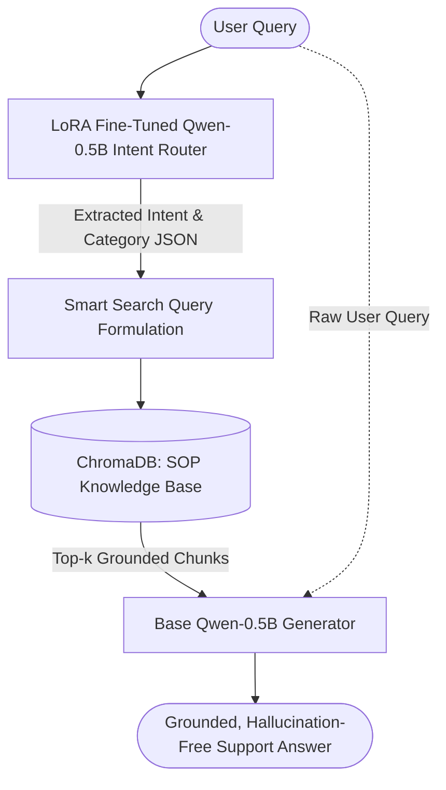
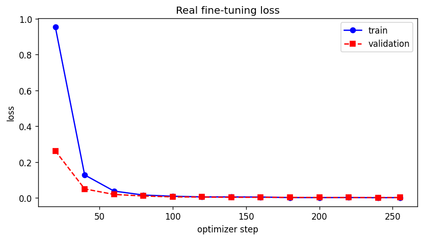
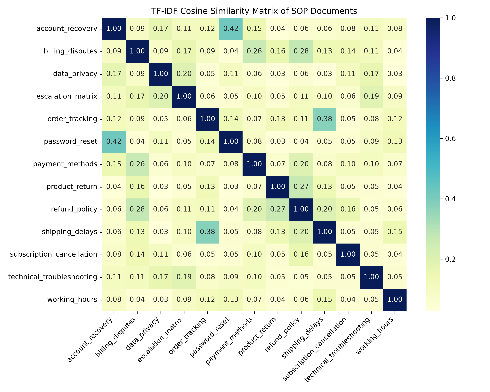
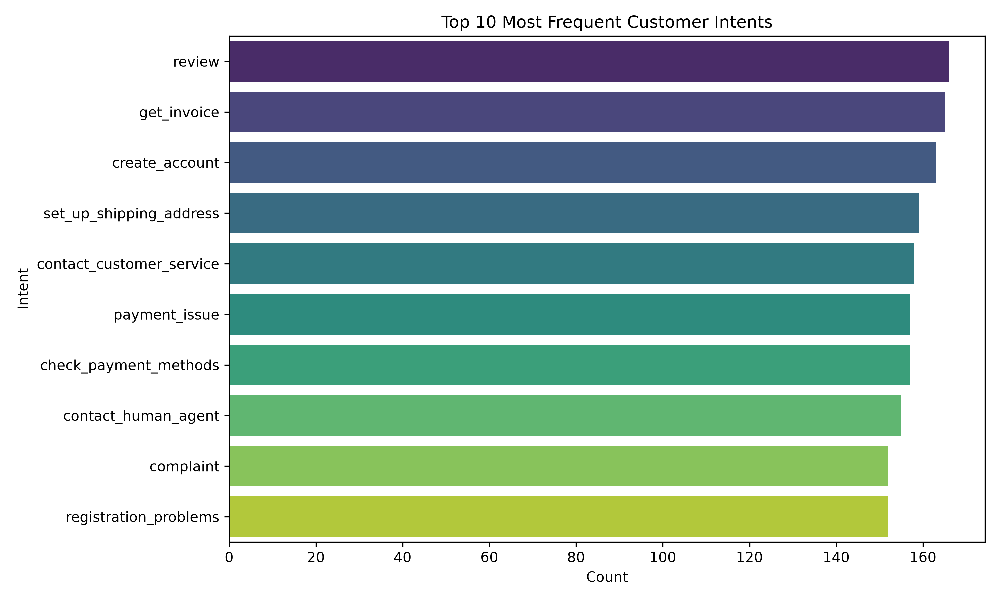

# 💬 Hybrid RAG Customer Support Assistant

An end-to-end customer support assistant combining **Fine-Tuned Intent Routing (LoRA)** with **Domain-Grounded Retrieval Augmented Generation (ChromaDB)**.

[](https://hybrid-rag-intent-lora-support.streamlit.app/)
[](https://github.com/Rakeshpawade/hybrid-rag-intent-lora)
[](https://www.python.org/)
[](https://huggingface.co/Qwen/Qwen2.5-0.5B-Instruct)
[](https://github.com/huggingface/peft)

🔗 **Try the Live Web App:** [https://hybrid-rag-intent-lora-support.streamlit.app/](https://hybrid-rag-intent-lora-support.streamlit.app/)

---

## 🖥️ App Overview & UI Features

When a user or recruiter interacts with the app, the pipeline dynamically demonstrates intent classification, semantic retrieval, and policy-grounded generation:

```text
┌─────────────────────────────────────────────────────────────────────────────────┐
│  💬 Hybrid RAG Customer Support Assistant                                      │
│  Runs 100% locally · fine-tuned intent router + RAG over SOP knowledge base     │
│                                                                                 │
│  👤 User: Where is my order? It was supposed to arrive yesterday.              │
│                                                                                 │
│  🤖 Assistant:                                                                  │
│  ┌─────────────────────────┐  ┌───────────────────────┐                         │
│  │  intent: track_order    │  │   category: order     │                         │
│  └─────────────────────────┘  └───────────────────────┘                         │
│  📎 Sources: order_tracking.md                                                  │
│                                                                                 │
│  To check the status of your order, please log into your account and navigate   │
│  to the 'Order History' section to locate your real-time tracking number.       │
│                                                                                 │
│  ▼ Retrieved context (2 chunks)                                                 │
│    • [1] order_tracking.md · similarity 0.884                                   │
│    • [2] shipping_delays.md · similarity 0.761                                  │
│                                                                                 │
│  ▼ Pipeline trace (JSON router output & latency)                                │
│    • {"router_raw_output": "{\"intent\": \"track_order\"}", "timings_s": 0.42}   │
└─────────────────────────────────────────────────────────────────────────────────┘
```

### Key UI Features:
1. **Interactive Sample Buttons:** One-click customer queries covering order tracking, refunds, password recovery, billing disputes, and human escalations.
2. **Intent Badges:** Color-coded badges indicating the structured JSON output (`intent` and `category`) from the fine-tuned LoRA router.
3. **Source Attribution & Cosine Similarity:** Transparent citations showing exactly which SOP policy file and chunk informed the answer.
4. **Pipeline Trace:** Expandable debugging telemetry showing search query formulations and execution latency.
5. **Configurable Retrieval Sidebar:** Adjust top-k chunk retrieval on the fly and monitor adapter status.

---

## 📌 Architecture Overview



1. **Dual-Role Single Model Architecture:** A single `Qwen/Qwen2.5-0.5B-Instruct` backbone serves both routing and generation:
   * **Adapter Active:** Fast, structured intent classification (extracts user intent and category as JSON).
   * **Adapter Disabled:** Grounded response synthesis using standard operating procedure (SOP) context.
2. **Context-Aware Retrieval:** Semantic vector search with `sentence-transformers/all-MiniLM-L6-v2` over company policy / SOP documents in `ChromaDB`.
3. **Safety & Fallback:** Built-in validation ensures if JSON intent parsing fails, the pipeline gracefully falls back to raw semantic search.

---

## 📊 Model Training & Evaluation Visuals

| Fine-Tuning LoRA Curves | SOP Retrieval Cosine Similarity | Top Customer Support Intents |
|:---:|:---:|:---:|
|  |  |  |

---

## 🛠️ Tech Stack

| Component | Technology | Description |
|---|---|---|
| **Base LLM** | `Qwen/Qwen2.5-0.5B-Instruct` | Lightweight causal LM for intent classification & generation |
| **Fine-Tuning** | `PEFT / LoRA` | Domain-adapted adapter for customer support intent routing |
| **Embeddings** | `sentence-transformers/all-MiniLM-L6-v2` | Dense representations for semantic search |
| **Vector Store** | `ChromaDB` | Embedded vector database with cosine similarity search |
| **Frontend UI** | `Streamlit` | Interactive chat UI with live intent badges and source attribution |

---

## 🚀 Quickstart (Run Locally)

### 1. Clone repository & set up environment
```bash
git clone https://github.com/Rakeshpawade/hybrid-rag-intent-lora.git
cd hybrid-rag-intent-lora
python -m venv .venv

# Windows:
.venv\Scripts\activate
# Mac / Linux:
source .venv/bin/activate
```

### 2. Install dependencies
```bash
pip install -r requirements.txt
```

### 3. Launch the app
```bash
streamlit run app.py
```
Open [http://localhost:8501](http://localhost:8501) in your browser.

---

## 📂 Project Structure

```text
├── app.py                      # Streamlit chat interface
├── requirements.txt            # Python dependencies (CPU-optimized PyTorch)
├── .streamlit/
│   └── config.toml             # Custom theme and server settings
├── rag/
│   ├── config.py               # Central configuration & intent-to-doc mappings
│   ├── llm.py                  # Dual-role causal LM loader with LoRA toggle
│   ├── retriever.py            # ChromaDB interface and semantic search
│   └── pipeline.py             # End-to-end RAG orchestrator
├── chroma_db/                  # Persistent ChromaDB vector store
├── models/
│   └── intent_lora_best/       # Fine-tuned LoRA adapter weights (~8.6 MB)
├── assets/                     # Architecture diagrams and evaluation plots
├── Hybrid_RAG_App_Creation_and_Deployment_Guide.pdf  # Complete documentation
└── README.md
```

---

## 📄 License
This project is licensed under the Apache 2.0 License.
