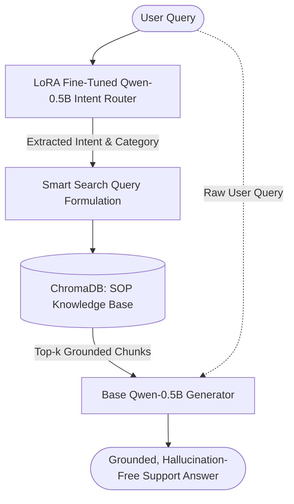

---
title: Hybrid RAG Customer Support Assistant
emoji: 💬
colorFrom: blue
colorTo: indigo
sdk: docker
app_port: 8501
pinned: false
---

# 🤖 Hybrid RAG Customer Support Assistant

An end-to-end customer support assistant combining **Fine-Tuned Intent Routing (LoRA)** with **Domain-Grounded Retrieval Augmented Generation (ChromaDB)**.

[](https://huggingface.co/spaces)
[](https://huggingface.co/spaces)
[](https://www.python.org/)

---

## 📌 Architecture Overview



1. **Dual-Role Single Model Architecture:** Uses a single `Qwen/Qwen2.5-0.5B-Instruct` backbone.
   * **Adapter Active:** Fast, structured intent classification (extracts user intent and category as JSON).
   * **Adapter Disabled:** Grounded response synthesis using standard operating procedure (SOP) context.
2. **Context-Aware Retrieval:** Semantic vector search with `sentence-transformers/all-MiniLM-L6-v2` over company policy / SOP documents in `ChromaDB`.
3. **Safety & Fallback:** Built-in validation ensures if JSON intent parsing fails, the pipeline gracefully falls back to raw semantic search.

---

## 🛠️ Tech Stack

| Component | Technology | Description |
|---|---|---|
| **Base LLM** | `Qwen/Qwen2.5-0.5B-Instruct` | Lightweight causal LM for intent classification & generation |
| **Fine-Tuning** | `PEFT / LoRA` | Domain-adapted adapter for customer support intent routing |
| **Embeddings** | `sentence-transformers/all-MiniLM-L6-v2` | Dense sentence representations for retrieval |
| **Vector Store** | `ChromaDB` | Embedded vector database with cosine similarity search |
| **Frontend UI** | `Streamlit` | Interactive chat UI with live intent badges and source attribution |

---

## 🚀 Quickstart (Run Locally)

### 1. Clone repository & set up environment
```bash
git clone https://github.com/<your-username>/hybrid-rag-support.git
cd hybrid-rag-support
python -m venv .venv
# Windows:
.venv\Scripts\activate
# Mac / Linux:
source .venv/bin/activate
```

### 2. Install dependencies
```bash
pip install -r requirements.txt
```

### 3. Launch the app
```bash
streamlit run app.py
```
Open [http://localhost:8501](http://localhost:8501) in your browser.

---

## 📂 Project Structure

```text
├── app.py                      # Streamlit chat interface
├── requirements.txt            # Python dependencies (CPU-optimized PyTorch)
├── .streamlit/
│   └── config.toml             # Custom theme and server settings
├── rag/
│   ├── config.py               # Central configuration & intent-to-doc mappings
│   ├── llm.py                  # Dual-role causal LM loader with LoRA toggle
│   ├── retriever.py            # ChromaDB interface and semantic search
│   └── pipeline.py             # End-to-end RAG orchestrator
├── chroma_db/                  # Persistent ChromaDB vector store
├── models/
│   └── intent_lora_best/       # Fine-tuned LoRA adapter weights (~8.6 MB)
└── README.md
```

---

## 📄 License
This project is licensed under the Apache 2.0 License.
